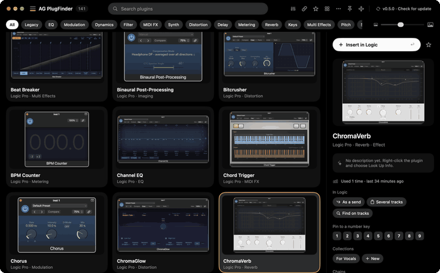
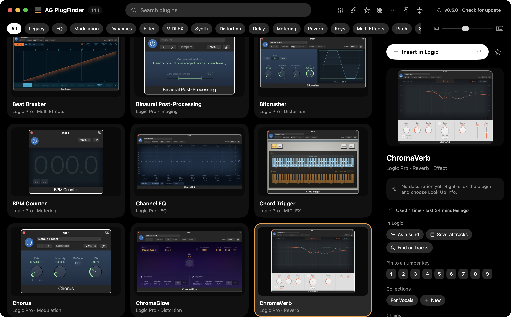
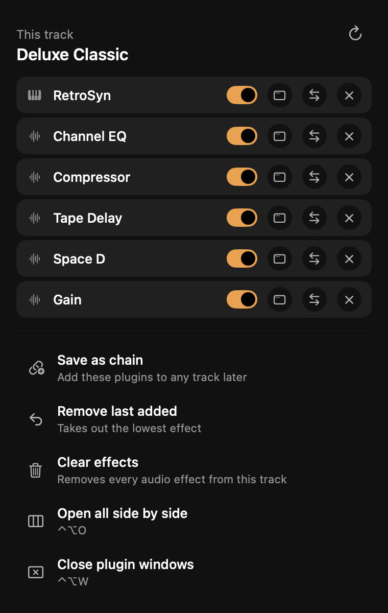
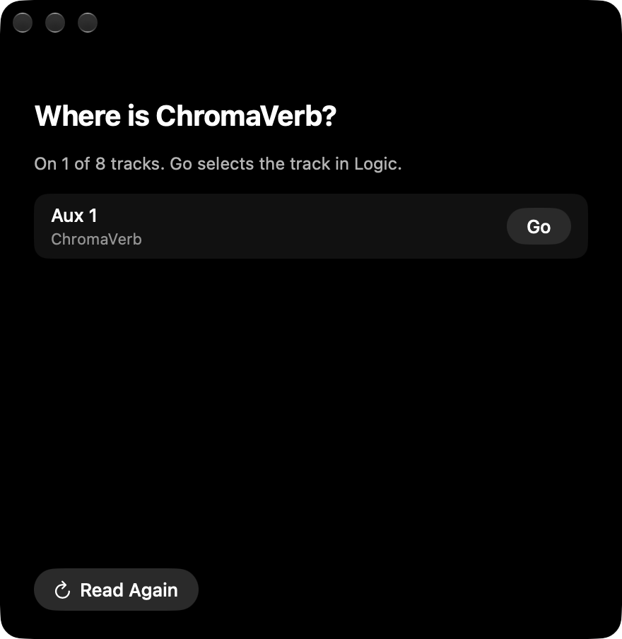
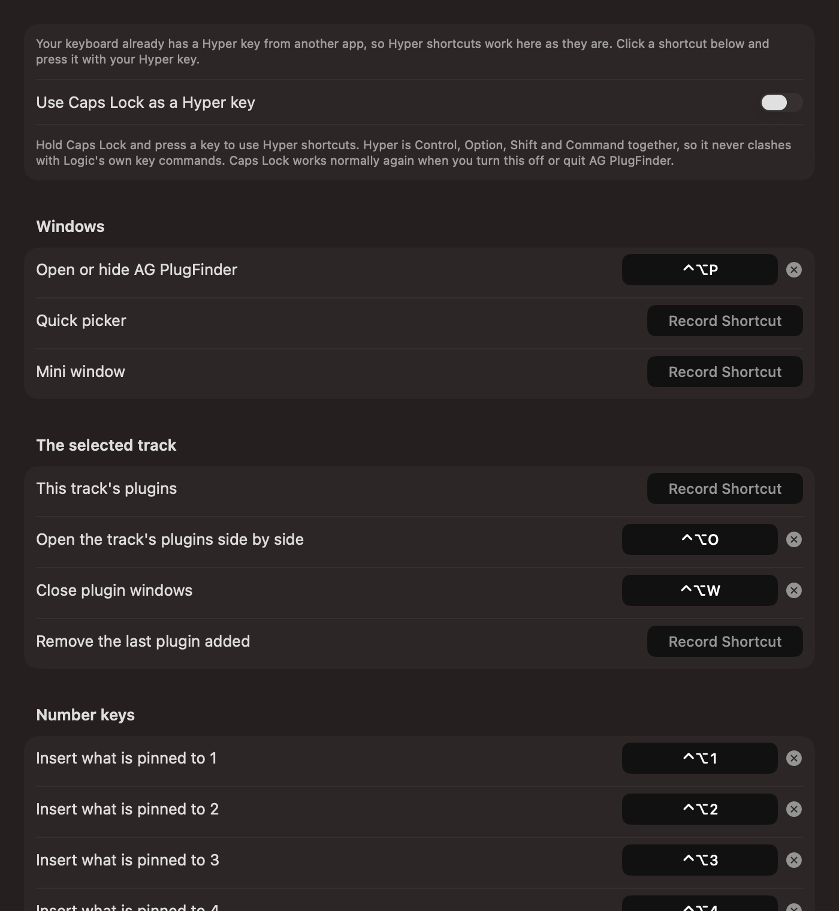
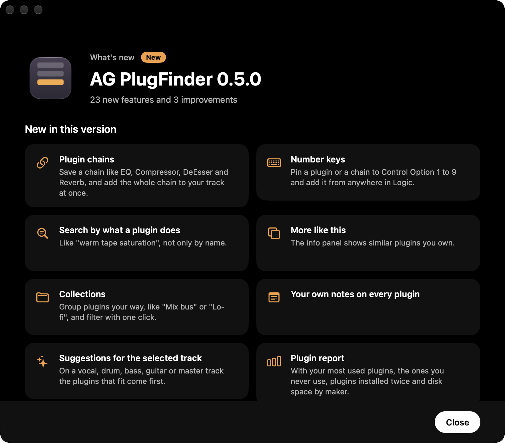

<p align="center">
  
</p>

<h1 align="center">AG PlugFinder</h1>

<p align="center">
  <b>Find any plugin by how it looks, and put it on your Logic Pro track in one keystroke.</b><br>
  Every plugin you own, with a picture of its real window, a search that understands what you mean,<br>
  and full control of the selected track's plugins without touching the mouse.
</p>

<p align="center">
  <a href="https://github.com/adigold/AG-PlugFinder/releases/latest/download/AG-PlugFinder.dmg"><b>Download for Mac</b></a>
  &nbsp;·&nbsp; macOS 15 or later &nbsp;·&nbsp; Logic Pro &nbsp;·&nbsp; Free
</p>

<p align="center">or with Homebrew: <code>brew tap adigold/tap && brew trust adigold/tap && brew install --cask ag-plugfinder</code></p>

---

## Why

You know the plugin you want. You can picture its window. But Logic's plugin menu is a long list of names, grouped by maker, three levels deep. AG PlugFinder shows every plugin as a picture you recognise at a glance, finds it as you type, and drops it on your track the moment you press Return.

<p align="center">
  
</p>

## Find

- **Every plugin, with a picture.** Your Audio Units and Logic's own plugins, each with a screenshot of its real window. Pictures of 122 of Logic's plugins come built in, and pictures other users shared arrive ready-made, so a new install is ready straight away.
- **Search by name or by what it does.** Type "warm tape saturation", "punchy drums" or "shimmer reverb", not only names. Plugins that stop matching fade away and the rest glide into place.
- **Pills for every category.** One click shows only EQs, reverbs, compressors, limiters and so on. ⌘-click to see several categories together. Collections look different: outlined, with a small stack icon.
- **Press Space to preview.** See a plugin large, with its picture, what it is, its best feature and highlights. Arrows move to the next one, Return adds it to Logic, Space closes. After typing a search, press Tab to move to the results; Shift+Tab goes back to the search.
- **Find Similar.** Inside the preview, see plugins like the one you are looking at, and click one to preview it.
- **Shuffle.** Click the die in the top bar and land on a random plugin. With a category or a search showing, it picks only from those.
- **Mono and stereo as one.** A plugin's mono and stereo versions show as one card with an M/S mark, and Logic gets the version that fits the track. Turn it off in Settings to see every version.
- **Picture size slider**, grid or list, and sorting by name, maker, category, recently used or most used (⌘1 to ⌘5).
- **Suggestions for the selected track.** On a track called Vocal, Drums, Bass, Guitar, Keys or Master, the plugins that fit come first.
- **Favorites, collections and your own notes** on every plugin. Drag a plugin onto a collection to add it, or drag across empty space to select many at once.
- **Maker's Website.** Opens the plugin's own page on its maker's site, right from the info panel.
- **Free descriptions.** On Macs with Apple Intelligence, plugin descriptions come free from the Mac itself, nothing to download. Or use the web lookup with your own key for the most detail.

## Make it yours

- **Edit Pills.** Choose which pills show, drag them into your own order or order them by most used, rename them, give them any color, pin your favorites to the front. Combine categories into a pill of your own, for example Space for Reverb and Delay. Pills that don't fit go into a More pill or wrap onto more rows.
- **Appearance.** Pick one of 9 themes, light or dark: AG Classic, Clean Light, Nord Light, Sakura Blossom, Clean Dark, Dracula Classic, Cyberpunk Neon, Emerald Forest and OLED Pitch Black. Set the text size for the whole app.
- **Your categories.** Right-click a plugin to set its category, for this Mac or for every AG PlugFinder user.
- **Hide what you don't use** by maker, category, format or type in Settings, Plugin List. Plugins you install while the app is open are found by themselves.
- **Keep it on top** of Logic, shrink it to a small floating mini window, or dock it as a Sideview at the side of your screen with every category as a row of pictures.

## Add to Logic

- **Return puts it on the track.** Instruments go into the instrument slot, effects into the first free insert, MIDI effects into the MIDI slot. Legacy Logic plugins too.
- **Add several at once.** Select several plugins and add them all to Logic in one click.
- **Point at a slot.** Point at a slot in Logic and press ⌃⌥I. Only plugins that fit it are shown, and the one you pick goes exactly there.
- **Always a proper instrument track.** Pick an instrument while an audio track, or a track that already has an instrument, is selected, and a new instrument track is made for it, named after the instrument.
- **Channel format.** Auto picks Stereo or Mono to Stereo to fit the track, or choose Ask me to pick each time.
- **Chains.** Save a chain like EQ, Compressor, DeEsser and Reverb, and add the whole chain at once.
- **Number keys.** Pin a plugin or a chain to a number and add it from anywhere in Logic.
- **Insert before or after** another plugin on the track.
- **As a send.** Choose a reverb or delay and it lands on a new aux with the send already set to a sensible level.
- **Several tracks at once.** Tick the tracks, press Add.

## Control the selected track

<p align="center">
  
  &nbsp;&nbsp;
  
</p>

- **See what is on the track**, in order, with an on and off switch for each plugin.
- **Drag to reorder.** Drag effects in the panel and the order changes in Logic too.
- **Open, replace or remove** any plugin. A replacement goes into the same slot, so your chain order stays.
- **Save the track as a chain**, then add it to any other track later.
- **Clean up.** Remove the last plugin you added, every effect, the ones turned off, or all sends.
- **Open all of the track's plugins side by side**, and close every plugin window with one key.
- **Find on tracks.** See every track in the project that uses a plugin, and jump to it.

## My Purchases

- **Licenses, subscriptions and bundles.** Record what you own, which subscription or bundle covers each plugin, what you paid and what it's worth, in about 40 currencies.
- **Reminders** before each subscription renews, with the amount, and before a trial ends.
- **Totals** for your collection's value, what you paid and what your subscriptions cost each month and year. Export it all to a spreadsheet.
- **Plugins you don't use**, with the disk space they take and what you paid. Hide them or show them in Finder in one click.
- **Plugin report** with your most used plugins, plugins installed twice and disk space by maker.

## Pictures

- **Taken for you.** The app opens each plugin once and takes its picture, with a progress window you can skip through.
- **Find it on the web** when a plugin's own window can't be opened. Pictures appear as they are found; click the one that shows the plugin.
- **Shared.** Pictures and categories are shared with other users, with each plugin's name and maker, so they get them without waiting. Nothing else about you or your Mac is sent. Turn it off in Settings.

## Plugin Manager

- **Every plugin, every format.** Audio Units, VST, VST3, AAX and CLAP, from your folders and the Mac's, with size, version and install date.
- **Duplicates.** Spots a plugin installed twice, an older version beside a newer one, and copies in formats Logic doesn't load. Nothing is ever ticked for you.
- **By installer.** See which installer put each plugin there, with the other files it left in your Library folders.
- **Nothing is deleted.** Removing moves the files into a dated folder on your Desktop, so you can always put them back.

## Ableton Live

- **Works in Live too.** Adds plugins and Ableton's own devices to the selected track in Live.
- **Follows the program you are using.** Logic's plugins while you work in Logic, Ableton's devices while you work in Live, and nothing to switch.
- **One setting in Live.** In Live's Settings, Link, Tempo & MIDI, choose AGPlugFinder as a Control Surface.

## Sync

Favorites, collections, chains, notes, number keys, hidden plugins, pills, purchases and subscriptions, your theme and text size, and your view choices sync with your other Macs through iCloud Drive, and you see the sync happen when you turn it on. Choose in Settings which of them each Mac shares. License keys stay on each Mac.

## Your keys

<p align="center">
  
</p>

Every action has its own shortcut, and you can change all of them in **Settings > Shortcuts**. Hyper key shortcuts (Control, Option, Shift and Command together) never clash with Logic's own key commands, and Caps Lock can become your Hyper key.

| Default | What it does |
|---|---|
| ⌃⌥P | Open AG PlugFinder, press again to go back to Logic |
| ⌃⌥1 to ⌃⌥9 | Add what you pinned to that number |
| ⌃⌥I | Show plugins for the slot under the pointer |
| ⌃⌥O | Open the track's plugins side by side |
| ⌃⌥W | Close plugin windows |
| Return | Add the selected plugin |
| Space | Preview the selected plugin |
| Arrows | Move through the results |
| Tab / Shift+Tab | From the search to the results, and back |
| ⌘D | Add to or remove from Favorites |
| ⌘F | Show favorites only |
| ⌘I | Show or hide the info panel |
| Esc | Clear the search |

## Always up to date

<p align="center">
  
</p>

Check for Update sits at the top right of the window. A new version downloads with live progress, is checked to be the genuine app, installs, and the app opens again by itself on a What's New page. Send feedback to Goldi from the help button at the top, with a screenshot if you like.

## Get started

1. [Download AG PlugFinder](https://github.com/adigold/AG-PlugFinder/releases/latest/download/AG-PlugFinder.dmg), open it and drag the app to Applications. Or install it with [Homebrew](https://brew.sh):

   ```sh
   brew tap adigold/tap
   brew trust adigold/tap
   brew install --cask ag-plugfinder
   ```
2. Open it. A short welcome tour asks for the one permission it needs: to work with Logic's plugin slots (System Settings > Privacy & Security). Nothing else in Logic is touched.
3. It finds your plugins and gets their pictures.
4. In Logic, select a track, press ⌃⌥P, type, press Return.

AG PlugFinder lives in the menu bar and can start when you log in.

<!-- release-notes:start -->
## Release notes

Everything each version brought, newest first. The same notes appear in the app's What's New window.

**0.9.39**

- **Fixed:** Dragging several chosen plugins onto a collection adds all of them, not only the one you dragged.

**0.9.38**

- **New:** Pictures of Ableton Live's own devices, from Amp to Wavetable.
- **New:** A small badge at the bottom left shows whether plugins go to Logic Pro or Ableton Live, and whether it is open.
- **Improved:** After adding to Ableton you get a message naming the track, or telling you what to turn on in Live when a plugin is missing.

**0.9.37**

- **New:** Ableton Live. AG PlugFinder now adds plugins and Ableton's own devices to the selected track in Live. It follows the program you are using: Logic's plugins while you work in Logic, Ableton's devices while you work in Live. Turn it on once in Live's Settings, Link, Tempo & MIDI, by choosing AGPlugFinder as a Control Surface.
- **New:** A thin footer with the version and Check for Update, and the tools sit together in the top-right corner.
- **Fixed:** The Plugin Manager scan no longer seems stuck after matching installers. The last step shows its own progress and runs much faster.

<details>
<summary><b>Earlier versions</b> (0.5.0 to 0.9.36)</summary>

**0.9.36**

- **New:** Choose what syncs. In Settings, each part of your library has its own switch, so every Mac can keep some things to itself.
- **New:** Your theme, text size and view choices now sync with your other Macs too.
- **New:** The Plugin Manager shows how many plugins and how much space your filter covers, and how much space the plugins you chose will free.
- **Faster:** Plugins you move in the Plugin Manager leave the list at once, with no new scan.

**0.9.35**

- **Improved:** Sidecar is now called Sideview.
- **Improved:** The Plugin Manager scan shows how many plugin files and installers are left, with a progress bar.
- **Faster:** The Plugin Manager stays quick with thousands of plugins. Ticking, searching and scrolling react at once.
- **New:** Select All and Deselect All buttons in the Plugin Manager.

**0.9.34**

- **New:** Sideview view. A tall panel at the side of your screen with every category as a row of plugin pictures. The view button in the top bar switches between Full Window, Sideview and Mini.
- **New:** Dynamics is split into Compressor, Limiter, Multiband, De-esser, Transient, Gate, Rider and Expander.
- **Improved:** The Plugin Manager shows each file as it scans, and scans faster.
- **Improved:** Plugins you remove in the Plugin Manager leave the library right away.
- **Improved:** The Effects category is gone. Its plugins moved to Specialized or Utility.

**0.9.33**

- **Fixed:** Removing plugins in the Plugin Manager works. It now asks on the same page, shows the name of the folder it creates on your Desktop, and tells you what was moved.
- **Fixed:** Save as chain finds Logic's plugins even when the track shows their short names, like SilvComp or SpecGate.
- **Fixed:** Save as chain tells you when a track has only an instrument and no effects to save.
- **Fixed:** An open chain in the Chains list is no longer cut off.

**0.9.32**

- **New:** Plugin Manager, in Settings. Every plugin on your Mac in every format: Audio Units, VST, VST3, AAX and CLAP.
- **New:** Find duplicates. The Plugin Manager shows plugins installed twice, older versions beside newer ones, and formats Logic doesn't load. Nothing is ticked for you.
- **New:** See plugins by installer, including the other files each installer left in your Library folders.
- **New:** Removing a plugin moves it into a folder on your Desktop instead of deleting it, so you can always put it back.

**0.9.31**

- **Improved:** Plugins you remove from your Mac disappear from the app by themselves, and the app tells you how many were removed.
- **Improved:** The Fix Failed Screenshots button can be hidden with its x. It comes back only if more screenshots fail.

**0.9.30**

- **Improved:** New pill defaults. Collections and categories show together, ordered by most plugins, with counts, and wrap onto more rows when there are many. Reset to Default in Edit Pills brings back this look. Settings you already chose stay as they are.

**0.9.29**

- **New:** Channel Strip pill. R-Channel, SSL strips, bx_console, Console 1, UltraChannel and other channel strips have their own category.
- **New:** Import from Logic, in Settings. Brings in the plugins you starred in Logic's Plug-in Manager and the categories you made there, as collections. Nothing in Logic changes.
- **New:** The info panel tells you when Logic recorded crashes with a plugin.

**0.9.28**

- **Improved:** Clicking a category or collection slides your plugins back to the top, so you always start at the first one.

**0.9.27**

- **New:** Fix Failed Screenshots. When some plugins show a failed screenshot, a button at the top checks again for pictures other users shared, adds the ones it finds, and tells you how many it fixed.

**0.9.26**

- **New:** Find Similar in the Space preview. See plugins like the one you are looking at, and click one to preview it.
- **New:** Shuffle. Click the die in the top bar to land on a random plugin. With a category or search showing, it picks only from those plugins.

**0.9.25**

- **New:** Appearance in Settings. Pick one of 9 themes, light or dark, and set the text size for the whole app. AG Classic keeps today's look.
- **New:** Turning on Sync with my other Macs shows the sync as it happens, and tells you when it is done.

**0.9.24**

- **New:** Mono and stereo versions of a plugin show as one, with an M/S mark. Logic gets the version that fits the track, and the info panel lets you pick one yourself. Turn it off in Settings if you prefer to see every version.
- **New:** After typing a search, press Tab to move to the results, then Space to preview. Shift+Tab goes back to the search.
- **Improved:** Licenses is now called My Purchases.
- **Improved:** Maker's Website opens Apple's Logic Pro page for Logic's own plugins, and the maker's home page when a plugin has no page of its own.
- **Fixed:** Plugin website links could be lost, so Maker's Website opened a web search instead of the plugin's page.

**0.9.23**

- **Improved:** Much faster with large libraries. Clicking, scrolling and searching stay quick even with thousands of plugins.
- **Improved:** More accurate categories and exact kinds for over 1,500 plugins, so limiters show under Limiter and compressors under Compressor.
- **Improved:** Maker's Website now opens the plugin's own page for most plugins.

**0.9.22**

- **New:** Compressor and Limiter have their own pills. Gates, de-essers and transient shapers stay in Dynamics.

**0.9.21**

- **Improved:** With the info panel closed, the button to open it sits right where the panel was, at the top right of your plugins.

**0.9.20**

- **New:** Questions and name boxes now match the app's look. Return confirms, Esc cancels.
- **New:** Order pills by Most used, so the categories you reach for most come first.
- **New:** Collections look different from categories: outlined, with a small stack icon.
- **New:** Close the info panel from its top corner, and bring it back from the top bar or with ⌘I.
- **Fixed:** Maker's Website for Logic's own plugins opens their page in Apple's Logic guide.

**0.9.19**

- **New:** Give a pill any color from a color map, in Edit Pills or from the pill's right-click menu.
- **New:** Inside a collection, select several plugins and remove them from it in one click.
- **New:** Maker's Website opens the plugin's page on its maker's site, right from the info panel.
- **Improved:** Esc closes Edit Pills, and the color circle is easier to click.

**0.9.18**

- **New:** Edit Pills. Choose which pills show, drag them into your own order, rename them, give them colors, pin your favorites to the front. Open it from the button at the end of the pills or in Settings.
- **New:** Combine categories into one pill of your own, for example Space for Reverb and Delay.
- **New:** ⌘-click pills to see several categories together.
- **New:** Pills that don't fit go into a More pill, or let them wrap onto more rows.
- **New:** Select several plugins and add them all to Logic in one click.
- **Improved:** With the preview open, one click on another plugin selects it.

**0.9.17**

- **Improved:** A click selects a plugin the moment you press, as fast as the arrow keys.

**0.9.16**

- **Improved:** Clicking a plugin selects it instantly. A double-click still adds it to Logic.

**0.9.15**

- **New:** Press Space to see a plugin large, with its picture, what it is, its best feature and highlights. Arrows move to the next one, Return adds it to Logic, Space closes. Turn it off in Settings.
- **New:** Click a plugin and the keyboard moves to your plugins. Start typing and it goes straight back to the search.
- **Improved:** Arturia plugins now show clean pictures, without the welcome window. Improved pictures download by themselves.

**0.9.14**

- **New:** Category changes you share now reach every AG PlugFinder user. After updating, you can share the changes you made before.
- **New:** When you change a category, choose Everyone or Only This Mac.
- **New:** Search by sound: try warm tape, wide, punchy drums or shimmer reverb.
- **New:** Plugins you don't use, with the disk space they take and what you paid. Hide them or show them in Finder in one click.

**0.9.13**

- **New:** Drag across empty space in the plugin grid to select many plugins at once. Hold ⌘ to add to the ones already selected.
- **New:** The welcome tour offers to sync your library and licenses with your other Macs.
- **Fixed:** The app no longer offers to send crash reports that aren't from your copy of the app.

**0.9.12**

- **New:** Licenses, subscriptions and bundles sync with your other Macs through iCloud Drive. License keys stay on each Mac.

**0.9.11**

- **New:** Add a single plugin's license with + Single License.
- **New:** Choose from about 40 currencies for your licenses.
- **New:** Licenses and Subscriptions is also in Settings.
- **Improved:** A new calendar for choosing dates, with quick choices like In 1 year.

**0.9.10**

- **Improved:** Licenses and Subscriptions has its own button in the top bar.
- **Improved:** A plugin's License section is now near the top of its info panel.

**0.9.9**

- **Improved:** The category buttons above the plugins use the full width. The track suggestion note now sits on its own line under them.

**0.9.8**

- **New:** Licenses and Subscriptions. Record what you own, which subscription or bundle covers each plugin, what you paid and what it's worth.
- **New:** A reminder before each subscription renews, with the amount, and before a trial ends.
- **New:** Totals for your collection's value, what you paid and what your subscriptions cost each month and year. Export it all to a spreadsheet.
- **New:** Select several plugins and set their license in one step.

**0.9.7**

- **New:** Plugins you install while the app is open are found by themselves, and their pictures are taken.
- **New:** A Rescan Plugins button in Settings, Plugin List tab.

**0.9.6**

- **Fixed:** Plugins whose window only showed a list of controls (iZotope Ozone, RX and others) now get their real look. Their old pictures are taken again once.
- **Improved:** When a plugin's own window can't be opened, its picture comes from the shared database, or you pick it on the web with Find Real Pictures on the Web.

**0.9.5**

- **New:** Picture options right under the picture in the info panel: retake it, find it on the web, go back to the database picture, undo a change.
- **New:** Use the Database Picture brings back the shared picture (or the built-in one for Logic's own plugins) after you picked another.
- **New:** Add your name and email to feedback if you'd like a reply.
- **Improved:** Pictures found on the web are the plugin itself, not a website's banner.
- **Improved:** Every plugin, Logic's own too, can get a picture from the web.
- **Improved:** The favorite star shows on every card size.

**0.9.4**

- **New:** Find a plugin's picture on the web in seconds. Pictures appear as they are found; click the one that shows the plugin. Search Google Images opens your browser, then drag the picture back or paste it.
- **New:** After taking pictures, Find Real Pictures on the Web offers the plugins that failed or only showed their basic controls.
- **New:** Skip This Plugin while pictures are being taken, with a counter for the plugin being opened. A maker whose plugins keep failing is skipped instead of tried one by one.
- **Improved:** The feedback button sits next to the version at the top.

**0.9.3**

- **New:** Send feedback to Goldi from the help button at the top. Report something that's wrong, share an idea or ask a question, and attach a screenshot. You'll see when it's being worked on and when it's fixed.
- **New:** Find a plugin's picture on the web when taking it fails. Right-click the plugin, or select several. Needs your API key in Settings > Plugin info.
- **Improved:** More plugins get their picture, including Waves and other plugins that stopped before.
- **Improved:** The search field always types in English, even when your Mac's keyboard is set to another language.
- **Improved:** Cancel on the Share this with other users question keeps the plugin's old category.
- **Improved:** Better categories for more plugins.

**0.9.2**

- **New:** Set a plugin's category yourself. Right-click it and choose Category, or select several and set them all at once. Share your choice so other users' plugins are sorted the same way.
- **New:** Select several plugins with Command-click or Shift-click, then take their pictures, add them to Favorites or to a collection together.
- **New:** Pictures other users shared arrive ready-made, so fewer plugins need to be opened to take their picture.
- **Improved:** Many more plugins are sorted into the right category, including meters, imagers, channel strips, tape and console plugins.
- **Improved:** Take missing pictures also tries again the plugins whose picture failed before.
- **Improved:** An enlarged picture grows smoothly out of the card, with the screen behind it blurred.
- **Improved:** Large plugin pictures are shared too, and the plugin count reads "plugins found".

**0.9.1**

- **New:** Point at a slot in Logic and press Control Option I. The slot is outlined and only plugins that fit it are shown; pick one and it goes exactly there, replacing what was in it.
- **New:** Keys to remove or switch off the plugin under the pointer, and keys for Save as chain, Remove all effects, Remove the ones turned off and Remove all sends. Set them in Settings > Shortcuts.
- **New:** A star on every card adds a plugin to Favorites in one click. Removing a favorite asks first.
- **New:** Make a new collection from the + button in the top bar.
- **New:** Send Error Log to Goldi, in the menu bar menu and in Settings. If the app ever closes unexpectedly, it offers to send the report the next time it opens.
- **Improved:** Plugins from every maker are sorted into the right categories, such as Imaging, Metering, Drums and Keys.

**0.9.0**

- **New:** Help other users. Pictures the app takes of your plugins are shared, with each plugin's name and maker, so other users get them without waiting. Nothing else about you or your Mac is sent. Turn it off any time in Settings > Help other users.

**0.8.0**

- **Faster:** plugins go into Logic about twice as fast.
- **New:** Channel format. Auto picks Stereo or Mono to Stereo to fit the track, or choose Ask me to pick each time. Set it in Settings, or per plugin in its info panel.
- **New:** Remove all effects from a track in one step, plus Remove the ones turned off and Remove all sends, in the track panel.
- **New:** A cleaner menu bar icon.
- **Fixed:** Taking plugin pictures no longer stops on a plugin's own popup, and a plugin that can't be pictured isn't tried again on every scan.

**0.7.0**

- **New:** Free plugin descriptions on Macs with Apple Intelligence. Nothing to download, nothing leaves your Mac. Choose it in Settings > Plugin info.
- **New:** Click a plugin's picture to see it large. Pinch or double-click to zoom in.
- **New:** Drag a plugin onto a collection at the top to add it there.
- **New:** Install with Homebrew.

**0.6.2**

- **Improved:** AG PlugFinder checks for a new version as soon as it opens, and shows you what's new with one click to install.
- **Improved:** Choosing an instrument while the track already has one makes a new instrument track for it, named after the instrument.

**0.6.1**

- **New:** Share AG PlugFinder on X, WhatsApp, Messages, Instagram, Telegram, Facebook, LinkedIn or by email, with a ready-made picture.
- **New:** Drag effects in the track panel to change their order in Logic.
- **Improved:** The Hyper key setting says plainly when another app already makes Caps Lock your Hyper key.

**0.6.0**

- **New:** A beautiful What's New window, so you see everything a new version brings.
- **New:** Set your own shortcut for every action in Settings, including Hyper key shortcuts.
- **New:** Use Caps Lock as a Hyper key.
- **New:** A slider sets how big the plugin pictures are.
- **New:** Loading an instrument while an audio track is selected creates a new instrument track for it.
- **Improved:** Category buttons show above your plugins from the start.

**0.5.0**

- **New:** Plugin chains. Save a chain like EQ, Compressor, DeEsser and Reverb, and add the whole chain to your track at once.
- **New:** Number keys. Pin a plugin or a chain to Control Option 1 to 9 and add it from anywhere in Logic.
- **New:** Search by what a plugin does, like "warm tape saturation", not only by name.
- **New:** More like this. The info panel shows similar plugins you own.
- **New:** Collections. Group plugins your way, like "Mix bus" or "Lo-fi", and filter with one click.
- **New:** Your own notes on every plugin.
- **New:** Suggestions for the selected track. On a vocal, drum, bass, guitar or master track the plugins that fit come first.
- **New:** Plugin report with your most used plugins, the ones you never use, plugins installed twice and disk space by maker.
- **New:** Sync favorites, collections, chains, notes and number keys with your other Macs through iCloud Drive.
- **New:** A beautiful update window with live progress. Updates install and the app reopens by itself.
- **New:** Pictures of 122 of Logic Pro's own plugins come built in.
- **New:** Legacy Logic plugins insert straight into your track.
- **New:** While you search, plugins that no longer match fade away and the rest glide into place.
- **Improved:** Instruments always go into the instrument slot and effects into the first free insert.
- **Improved:** A new, cleaner dark design across the whole app.
- **New:** See the plugins on your selected track, turn each one on or off, open it, replace it or remove it.
- **New:** Save the plugins on a track as a chain in one click.
- **New:** Remove the last plugin you added, or clear every effect from a track.
- **New:** Insert an effect before or after another one on the track.
- **New:** Find every track that uses a plugin and jump to it.
- **New:** Add a plugin or a chain to several tracks at once.
- **New:** Add an effect as a send. AG PlugFinder sets up the bus and the aux, at a sensible level.
- **New:** Start a new instrument track with the instrument you pick.
- **New:** Control Option O opens all plugins on the track side by side, Control Option W closes plugin windows.
- **New:** Category buttons above your plugins, next to your collections or on their own (Settings).
- **Improved:** Control Option P now opens the main window. Press it again to go back to Logic.

</details>

See every download on the [Releases page](https://github.com/adigold/AG-PlugFinder/releases).
<!-- release-notes:end -->

## Build it yourself

```sh
brew install xcodegen
xcodegen generate
open AGPlugFinder.xcodeproj
```

---

<p align="center">Made by Adi Goldstein for everyone who makes music in Logic Pro.</p>
